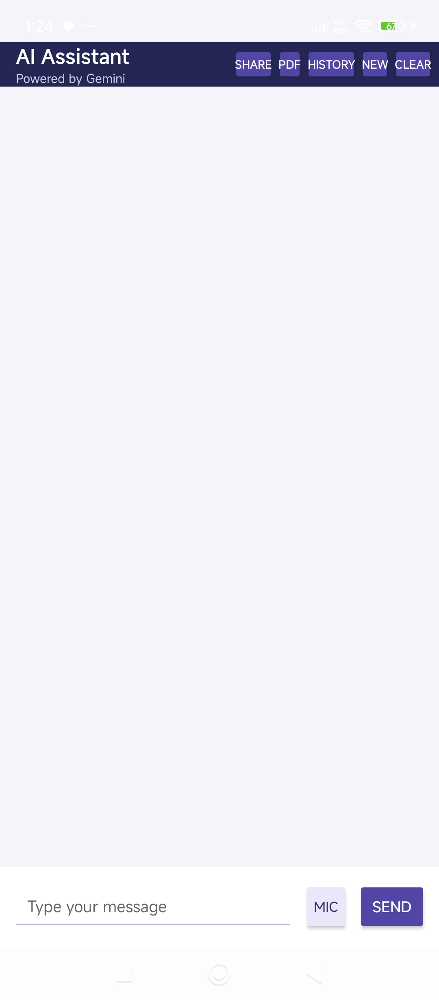
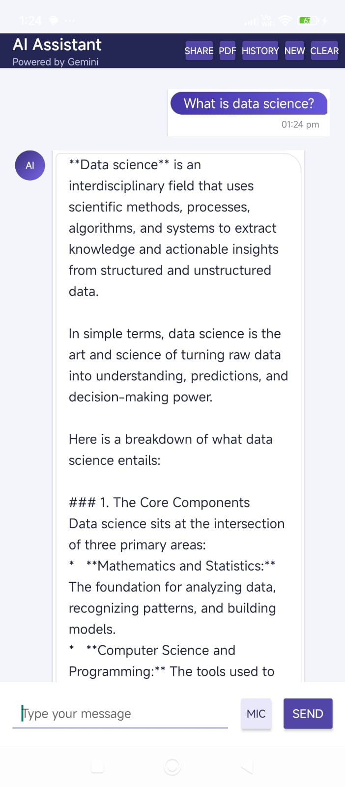
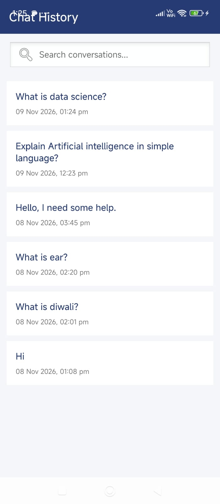

# AI Chat Assistant Android App

An Android-based AI Chat Assistant built using **Kotlin, Firebase AI Logic (Gemini), and Room Database**. The application allows users to interact with an AI assistant, manage multiple conversations, search chat history, use voice input, and export conversations as PDF files.

## Features

- **AI-Powered Chat:** Generate responses using Firebase Gemini AI.
- **Multiple Conversations:** Create and manage separate chat conversations.
- **Chat History:** View and reopen previously saved conversations.
- **Local Data Storage:** Store conversations and messages using Room Database.
- **Search Chat History:** Search across saved conversations and messages.
- **Delete Conversations:** Delete individual conversations.
- **Copy & Share Messages:** Copy or share individual messages.
- **Share Full Conversation:** Share an entire conversation.
- **PDF Export:** Export conversations as PDF files.
- **Voice Input:** Convert speech into text using Android Speech Recognition.
- **Timestamps:** Display message timestamps.
- **Error Handling:** Handle internet connectivity and AI response errors.

## Tech Stack

- **Language:** Kotlin
- **Platform:** Android
- **IDE:** Android Studio
- **AI Integration:** Firebase AI Logic (Gemini)
- **Database:** Room Database
- **UI:** XML Layouts, RecyclerView
- **Architecture Components:** Android Lifecycle and Coroutines
- **Version Control:** Git & GitHub

## App Screenshots

### 1. Home Screen


### 2. AI Response


### 3. Chat History


### 4. Voice Input


### 5. PDF Export


## Setup Instructions

1. Clone this repository:

   ```bash
   git clone https://github.com/Kirtisharma123/AI-Chat-Assistant-Android.git
   ```

2. Open the project in Android Studio.

3. Configure Firebase for your Android application and register your own Firebase Android app.

4. Add your Firebase configuration file (`google-services.json`) inside the `app/` directory.

5. Enable Firebase AI Logic and configure the appropriate App Check provider.

6. Sync Gradle and run the application on an Android device or emulator.

## Security Note

The Firebase configuration file is excluded from this repository using `.gitignore`. Configure your own Firebase project before running the application.

## Future Improvements

- Add user authentication.
- Add AI-powered features and enhancements.
- Improve UI/UX design.

## Author

**Kirti Sharma**

[GitHub Profile](https://github.com/Kirtisharma123)
